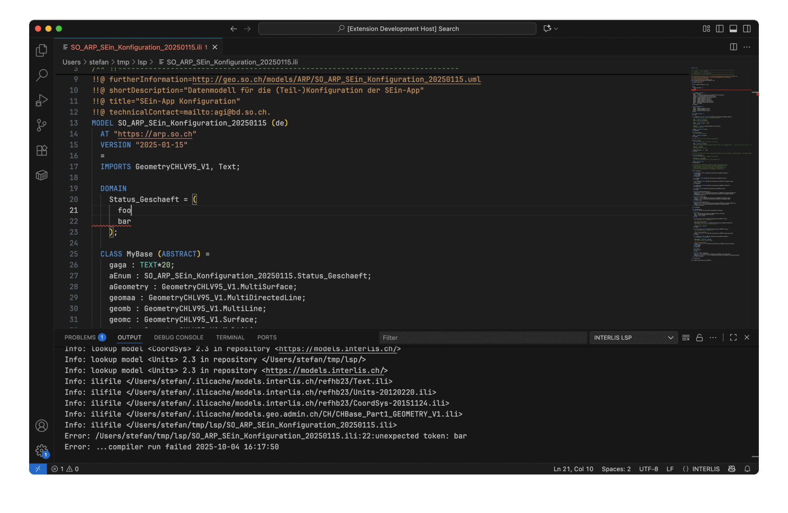

# INTERLIS Editor

<p align="center">

</p>

## Description
🛠️ The INTERLIS Editor extension brings the full INTERLIS-focused language server directly into VS Code. It understands `.ili` models, validates them with [ili2c](https://github.com/claeis/ili2c), and augments the authoring experience with completions, code navigation, formatting, diagrams, and documentation exports. The extension bundles the Java server and runtime so teams can share a reproducible setup while still allowing power users to point to custom installations.

## Features

### Language server highlights ✨
- **Validation with diagnostics** ✅ – the server compiles INTERLIS models on open and save, converts ili2c messages to LSP diagnostics, and streams the compiler log to the client output channel for quick feedback.
- **Smart completions** 🎯 – context-aware proposals for `IMPORTS`, dotted type references, and model names are built from the live compilation result and discovered repositories.
- **Go to definition** 🔍 – jump to definitions inside the current workspace or linked model files based on the compiled transfer description.
- **Symbol rename** ✏️ – rename models, topics, classes, structures, and associations while updating matching references across files.
- **Document symbols** 🗂️ – browse topics, classes, associations, domains, and attributes via the VS Code outline populated from the INTERLIS AST.
- **Formatting & pretty print** 🧹 – format whole documents with ili2c’s pretty printer and on-type helpers.
- **On-type templates** ⚙️ – typing `=` after model, topic, class, or structure headers injects boilerplate blocks, meta-attributes, and matching `END` statements while restoring the caret.
- **Cached compilation** 💾 – results are cached between document events for responsive completions and navigation.
- **Diagram generation** 🖼️ – generate Mermaid, PlantUML, GraphML, or GLSP UML diagrams from the compiled model with shared configurable rendering options.
- **GLSP diagram editor (topic containers)** 🧭 – open a dedicated `.ili` diagram editor beside the source view; it renders classes inside topic containers from the compiled transfer description via an embedded Eclipse GLSP server.
- **HTML & DOCX exports** 📄 – render human-readable documentation (including custom titles) as HTML or export styled Word documents.

HTML documentation includes `(Topic)` headings, direct and inherited UNIQUE definitions with their origins, and association sections with role tables, optional attributes, and UNIQUE definitions, matching the Word export.

### VS Code client experience 💡
- **Activation on INTERLIS files** 📂 – the extension activates for `.ili` files and contributes a TextMate grammar and language configuration for syntax highlighting and editor defaults.
- **Bundled runtime** 📦 – ships with a self-contained fat JAR and optional platform-specific JRE; paths can be overridden via settings.
- **Commands palette** 🎛️ – run "New from Template", "Compile current file", "Show Mermaid UML class diagram", "Show PlantUML class diagram", "Show documentation as HTML", and both GLSP SVG export commands directly from VS Code.
- **Automatic side-by-side diagram opening** ↔️ – optionally opens the read-only diagram editor beside INTERLIS text files when they become active.
- **Integrated output channel** 📢 – compiler logs land in a dedicated "INTERLIS LSP" output channel that can clear itself when new runs start.
- **Configurable repositories** 🗄️ – choose preferred model repositories via settings passed to the server at initialization.
- **Remote model template** 🧾 – create a new unsaved INTERLIS document from a configurable remote template URL.
- **Caret-aware templates** 🧠 – caret tracking middleware makes sure auto-inserted templates leave the cursor at the expected position after edits are applied.
- **SVG exports** 💾 – GLSP diagrams can be exported either as a complete model diagram or as the currently visible viewport; both variants use a white background and default to the source model folder. Mermaid and PlantUML previews also support saving generated SVG diagrams.

### ilidoc comments while typing

Typing `/*` automatically produces `/***/`, with the cursor after the second `*`, ready for an ilidoc description: `/**Description*/`. This uses the existing `editor.formatOnType` and `editor.autoClosingComments` settings; disabling either leaves the normal editor behaviour. Strings, existing comments, explanations and multiple cursors are not promoted. Block-comment toggling and Enter behaviour are unchanged.

### Formatting on save

INTERLIS files are formatted on save by default using ili2c’s pretty printer. Manual **Format Document** also formats unsaved changes. Only the current document's editor text is compiled; imports use saved files and configured repositories.

If compilation fails (including syntax errors, semantic errors, or missing imports), formatting makes no changes and saving continues. Normal save validation reports the errors. Compiler warnings do not prevent formatting.

To disable automatic formatting, add this to your VS Code user or workspace settings (set it to `true` to enable it again):

```json
"[interlis]": {
  "editor.formatOnSave": false
}
```

### Automatic Mermaid updates

An open Mermaid diagram refreshes after its source model finishes compiling on save, and when UML display settings change. It does not open a closed diagram or move editor focus. Zoom, pan, and the source-code pane are preserved; use **Fit** to show the whole graph again.

If the saved model is invalid, the last valid diagram remains visible with **Last valid diagram snapshot shown**. Display settings also apply to this last valid model. Saving an empty source clears the diagram and disables export until a valid model is available again. SVG export and copied Mermaid code always use the displayed snapshot. Automatic updates reuse saved compiler results; they do not compile again. Saving an imported model alone does not refresh diagrams of dependent models.

### Network errors

Repository and template download failures are explained in the **INTERLIS LSP** output channel without additional network pop-ups. Messages distinguish recognized timeouts, DNS, connection, certificate, and HTTP errors; they do not assume that your computer is offline. Check the indicated server/address, network, VPN, or proxy. Technical compiler details remain in the output; template download causes are recorded in **INTERLIS LSP Debug**.

Timeouts and retry behaviour are unchanged: templates have a three-second timeout; ili2c repository requests retain their existing connection/read timeouts (15/40 seconds per access, not an overall deadline). If compilation fails, formatting is skipped and saving can continue. A missing import by itself is still reported as a model-resolution error.

### Example: MODEL template via completion 🧱
After `INTERLIS 2.4;`, trigger completion on a new top-level line and choose the `MODEL` template. It inserts a documentation banner, example meta-attributes, and a full `MODEL ... END` block with editable stops for model name, language, URL, and version. The four header fields are intentionally popup-free, so `Tab` and `Enter` just move to the next placeholder:

```ili
/** !!------------------------------------------------------------------------------
 * !! Version    | wer | Änderung
 * !!------------------------------------------------------------------------------
 * !! 2024-12-09 | abr  | Initalversion
 * !!==============================================================================
 */
!!@ technicalContact=mailto:acme@example.com
!!@ furtherInformation=https://example.com/path/to/information
!!@ title="a title"
!!@ shortDescription="a short description"
!!@ tags="foo,bar,fubar"
MODEL MyNewModel (de)
  AT "https://example.com"
  VERSION "2024-12-09"
  =
  -- cursor moves here
END MyNewModel.
```

### Example: generating UML and documentation 🗺️
1. Open an `.ili` file and run **INTERLIS: Compile current file** to validate it.
2. Run **INTERLIS: Show Mermaid UML class diagram** to open an interactive Mermaid diagram, or **INTERLIS: Show PlantUML class diagram** for PlantUML output.
3. Use **INTERLIS: Show documentation as HTML** for a rendered manual, or **INTERLIS: Export documentation as DOCX** to save a styled Word file.

### Example: exporting a GLSP diagram as SVG 🖼️
1. Open the GLSP diagram editor for an `.ili` model.
2. Run **INTERLIS: Export GLSP diagram as SVG** to export the complete diagram, independent of the current zoom and scroll position.
3. Run **INTERLIS: Export visible GLSP diagram as SVG** to export only the current viewport.
4. The save dialog suggests `Model.svg` or `Model-visible.svg` in the folder of the `.ili` file. Both exports contain a white background and Inkscape connector metadata for classes and connection lines. The SVG uses semantic grouping: topics/containers, classes, and connections remain separately editable groups, while technical GLSP/Sprotty wrapper groups are removed. Classes can therefore be moved as a unit in Inkscape. The default GLSP layout uses `POLYLINE`, so connections may contain diagonal straight segments; `ORTHOGONAL` and `SPLINES` remain available through `interlisLsp.diagram.layout.edgeRouting`. Association names and cardinalities remain part of the connection group, but Inkscape does not automatically reposition them when it reroutes a connector.

### Example: creating a new model from a template 🧱
1. Run **INTERLIS: New from Template** from the command palette.
2. The extension downloads the configured template and opens it as a new unsaved INTERLIS document.
3. Optionally override `interlisLsp.template.url` in the settings to point to your own template source.

### Configuration options ⚙️
- `interlisLsp.server.jarPath` – override the bundled language server JAR.
- `interlisLsp.javaPath` – point to a custom Java runtime if the bundled runtime is missing.
- `interlisLsp.server.jvmArgs` – optional extra JVM arguments (for example `-Dinterlis.glsp.debugFile=/tmp/interlis-diagram-debug.json` to dump generated GLSP nodes/edges as JSON).
- `interlisLsp.modelRepositories` – comma-separated repositories resolved by the model discovery service and completion engine.
- `interlisLsp.template.url` – template URL used by **INTERLIS: New from Template**; leave empty to fall back to the default template.
- `interlisLsp.autoShowOutputOnStart` – show the INTERLIS output channel when the extension activates.
- `interlisLsp.diagram.autoOpenBeside` – auto-open the diagram editor beside `.ili` files.
- `interlisLsp.uml.attributeMode` – control Mermaid, PlantUML, GraphML, and GLSP UML diagrams with `OWN`, `NONE`, or `OWN_AND_INHERITED`; `NONE` hides attributes, enum values, and constraints. In Mermaid, it also removes empty member compartments and separators, leaving compact boxes sized to their names and stereotypes; SVG downloads use the same compact layout.
- `interlisLsp.uml.deemphasizeAbstractTypes` – tone down abstract classes and abstract structures in Mermaid, PlantUML, GraphML, and GLSP UML diagrams with a light gray palette; enabled by default.
- `interlisLsp.uml.showAssociationNames` – show or hide association role names in all UML diagram implementations; enabled by default.
- `interlisLsp.uml.showRoleCardinalities` – show or hide association role cardinalities in all UML diagram implementations; enabled by default.
- `interlisLsp.uml.showLocalEnumerationValues` – show or hide values of inline enumeration types declared directly on attributes in Mermaid, PlantUML, GraphML, and GLSP UML diagrams; enabled by default. When disabled, the attribute type is shown as `Enumeration`.

### Getting started 🚀
1. Install the extension from the Marketplace.
2. Open an INTERLIS workspace, create a new `.ili` file, or run **INTERLIS: New from Template**.
3. Start typing – validation, completions, and navigation features light up automatically.
4. Use the command palette (`Ctrl+Shift+P` / `Cmd+Shift+P`) to access the template, compilation, diagram, and export commands.

### Feedback & contributions 💬
Contributions and feedback are welcome! File issues or pull requests in the [interlis-lsp](https://github.com/edigonzales/interlis-lsp) repository.
